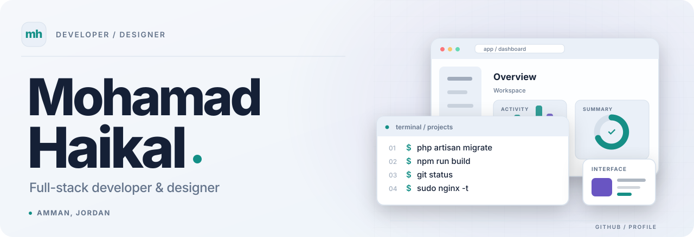
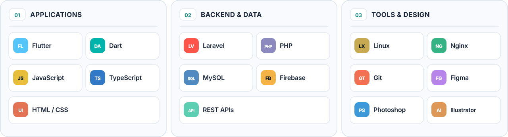

<!-- GitHub profile: github.com/Mohamad-Haikal -->

  <picture>
    <source media="(max-width: 600px) and (prefers-color-scheme: dark)" srcset="./assets/hero-mobile-dark.svg">
    <source media="(max-width: 600px)" srcset="./assets/hero-mobile-light.svg">
    <source media="(prefers-color-scheme: dark)" srcset="./assets/hero-dark.svg">
    
  </picture>

  <a href="https://mohamad-haikal.me"><picture><source media="(prefers-color-scheme: dark)" srcset="./assets/link-portfolio-dark.svg"></picture></a>
  &nbsp;
  <a href="https://www.linkedin.com/in/mohamad0haikal/"><picture><source media="(prefers-color-scheme: dark)" srcset="./assets/link-linkedin-dark.svg"></picture></a>
  &nbsp;
  <a href="https://github.com/Mohamad-Haikal?tab=repositories"><picture><source media="(prefers-color-scheme: dark)" srcset="./assets/link-repositories-dark.svg"></picture></a>

 

### About

I work on web and mobile apps, including their interfaces, backend APIs, and deployment. I'm based in Amman, Jordan, and study Computer Science at Al-Hussein Technical University.

### Tech stack

  <picture>
    <source media="(max-width: 600px) and (prefers-color-scheme: dark)" srcset="./assets/stack-mobile-dark.svg">
    <source media="(max-width: 600px)" srcset="./assets/stack-mobile-light.svg">
    <source media="(prefers-color-scheme: dark)" srcset="./assets/stack-dark.svg">
    
  </picture>

  I also like working on developer tools and desktop apps.

