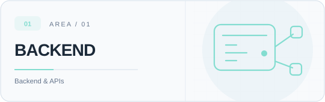
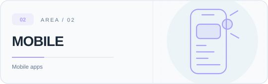
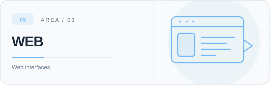
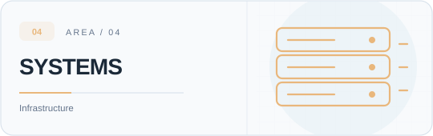
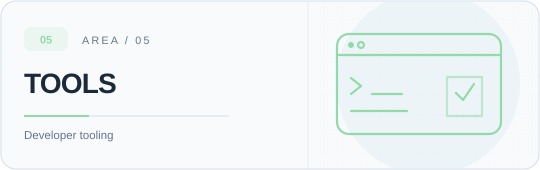
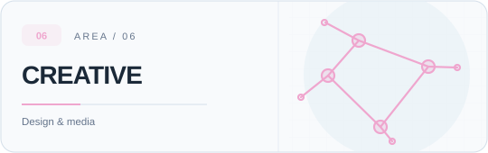
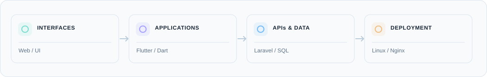

<!-- Mohamad Haikal | GitHub Profile -->

  <picture>
    <source media="(max-width: 600px) and (prefers-color-scheme: dark)" srcset="./assets/hero-mobile-dark.svg">
    <source media="(max-width: 600px)" srcset="./assets/hero-mobile-light.svg">
    <source media="(prefers-color-scheme: dark)" srcset="./assets/hero-dark.svg">
    
  </picture>

  <a href="https://mohamad-haikal.me"><picture><source media="(prefers-color-scheme: dark)" srcset="./assets/link-portfolio-dark.svg"></picture></a>
  &nbsp;
  <a href="https://www.linkedin.com/in/mohamad0haikal/"><picture><source media="(prefers-color-scheme: dark)" srcset="./assets/link-linkedin-dark.svg"></picture></a>
  &nbsp;
  <a href="https://github.com/Mohamad-Haikal?tab=repositories"><picture><source media="(prefers-color-scheme: dark)" srcset="./assets/link-repositories-dark.svg"></picture></a>

## About

I'm a **full-stack developer and designer** based in **Amman, Jordan**. I work on mobile and web applications, backend services, databases, and deployment. My background in visual design also shapes how I approach interfaces and usability.

I study **Computer Science at Al-Hussein Technical University (HTU)**.

## What I work on

<table>
  <tr>
    <td width="50%" valign="top">
       
      <picture><source media="(max-width: 600px) and (prefers-color-scheme: dark)" srcset="./assets/backend-mobile-dark.svg"><source media="(max-width: 600px)" srcset="./assets/backend-mobile-light.svg"><source media="(prefers-color-scheme: dark)" srcset="./assets/backend-dark.svg"></picture>
      <h3>Backend &amp; integrations</h3>
      
APIs, authentication, webhooks, background jobs, and external integrations.

       
    </td>
    <td width="50%" valign="top">
       
      <picture><source media="(max-width: 600px) and (prefers-color-scheme: dark)" srcset="./assets/mobile-mobile-dark.svg"><source media="(max-width: 600px)" srcset="./assets/mobile-mobile-light.svg"><source media="(prefers-color-scheme: dark)" srcset="./assets/mobile-dark.svg"></picture>
      <h3>Mobile applications</h3>
      
Flutter apps, notifications, maps, background tasks, and store releases.

       
    </td>
  </tr>
  <tr>
    <td width="50%" valign="top">
       
      <picture><source media="(max-width: 600px) and (prefers-color-scheme: dark)" srcset="./assets/frontend-mobile-dark.svg"><source media="(max-width: 600px)" srcset="./assets/frontend-mobile-light.svg"><source media="(prefers-color-scheme: dark)" srcset="./assets/frontend-dark.svg"></picture>
      <h3>Web interfaces</h3>
      
Responsive websites, admin dashboards, and multilingual interfaces.

       
    </td>
    <td width="50%" valign="top">
       
      <picture><source media="(max-width: 600px) and (prefers-color-scheme: dark)" srcset="./assets/platform-mobile-dark.svg"><source media="(max-width: 600px)" srcset="./assets/platform-mobile-light.svg"><source media="(prefers-color-scheme: dark)" srcset="./assets/platform-dark.svg"></picture>
      <h3>Servers &amp; deployment</h3>
      
Linux deployments, Nginx, server configuration, monitoring, and debugging.

       
    </td>
  </tr>
  <tr>
    <td width="50%" valign="top">
       
      <picture><source media="(max-width: 600px) and (prefers-color-scheme: dark)" srcset="./assets/devtools-mobile-dark.svg"><source media="(max-width: 600px)" srcset="./assets/devtools-mobile-light.svg"><source media="(prefers-color-scheme: dark)" srcset="./assets/devtools-dark.svg"></picture>
      <h3>Tools &amp; automation</h3>
      
VS Code extensions, scripts, CI/CD, and desktop tools.

       
    </td>
    <td width="50%" valign="top">
       
      <picture><source media="(max-width: 600px) and (prefers-color-scheme: dark)" srcset="./assets/design-mobile-dark.svg"><source media="(max-width: 600px)" srcset="./assets/design-mobile-light.svg"><source media="(prefers-color-scheme: dark)" srcset="./assets/design-dark.svg"></picture>
      <h3>Design &amp; multimedia</h3>
      
Interface design, visual identity, video, motion graphics, and 3D.

       
    </td>
  </tr>
</table>

## Technical stack

  <picture><source media="(max-width: 600px) and (prefers-color-scheme: dark)" srcset="./assets/workflow-mobile-dark.svg"><source media="(max-width: 600px)" srcset="./assets/workflow-mobile-light.svg"><source media="(prefers-color-scheme: dark)" srcset="./assets/workflow-dark.svg"></picture>

| Category | Technologies and tools |
| :--- | :--- |
| **Backend** | **PHP**, **Laravel**, REST APIs, webhooks, background jobs, API integrations |
| **Mobile** | **Dart**, **Flutter**, **Firebase**, FCM, Android, iOS, maps and location features |
| **Frontend** | **HTML**, **CSS**, **JavaScript**, **TypeScript**, responsive UI |
| **Databases** | **MySQL**, SQL, relational modeling, queries, views and stored procedures |
| **Infrastructure** | **Ubuntu / Linux**, **Nginx**, PHP-FPM, SSH, DNS, Git, **GitHub Actions**, CI/CD |
| **Developer tools** | VS Code extension development, Python scripting, Git/GitHub |
| **UI & graphic design** | **Figma**, **Adobe Illustrator**, **Photoshop** |
| **Media & 3D** | **Premiere Pro**, **After Effects**, **Blender** |

### Beyond my main stack

I also work with or explore **UEFN and Verse** for game systems, **Arduino** and basic electronics, **desktop development with Tauri**, and **AI/automation experiments**. These are separate from my core Laravel and Flutter work.

## Practical experience

My experience covers **e-commerce**, **education**, **mobile operations and location tracking**, **subscription and account services**, **admin tools**, and **interactive software**. These are areas of work, not a list of featured projects.

- **Mobile delivery:** Firebase messaging, mapping and live location features, Android/iOS builds, GitHub Actions, and mobile store release workflows.
- **Backend operations:** Webhooks and external API integration, service logs, background processes, and server-side troubleshooting.
- **Database work:** Designing relational schemas, writing queries, using views and stored procedures, and working with access permissions.
- **Product interfaces:** Dashboards, administration panels, roles and permissions, and Arabic/English (RTL/LTR) experiences.

## More

**Education:** Computer Science student, Al-Hussein Technical University (HTU)  
**Location:** Amman, Jordan  
**Languages:** Arabic, English  
**Links:** [Portfolio](https://mohamad-haikal.me) · [LinkedIn](https://www.linkedin.com/in/mohamad0haikal/) · [GitHub repositories](https://github.com/Mohamad-Haikal?tab=repositories)

 
<b>Other tools and areas I've worked with</b>
<ul>
  <li><strong>Game tools:</strong> Unreal Editor for Fortnite (UEFN), Verse, Blender, and gameplay prototyping.</li>
  <li><strong>AI experiments:</strong> Python scripts, image-generation workflows, and AI-assisted development tools.</li>
  <li><strong>Electronics:</strong> Arduino boards and HID / microcontroller experiments.</li>
  <li><strong>Desktop:</strong> Tauri and Rust experiments, including bilingual (Arabic/English) interface concepts.</li>
</ul>

